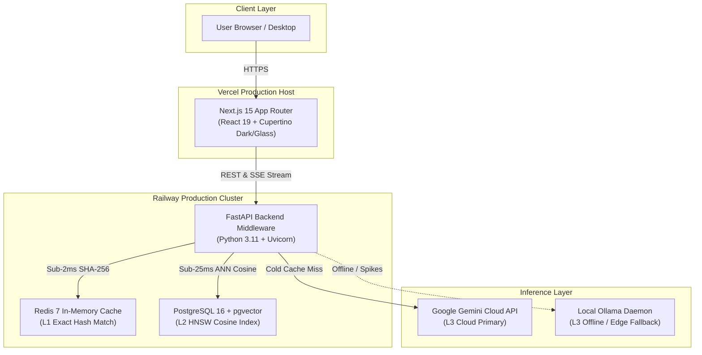

# 🚀 Cache-Craft Deployment Guide

This guide covers complete deployment workflows for **Cache-Craft**, including cloud production on **Railway** (Backend & Storage) and **Vercel** (Frontend), as well as multi-container deployment with **Docker Compose**.

---

## 🏗️ Architecture Overview



---

## 🚂 1. Backend Deployment on Railway

Railway hosts the FastAPI application server, Redis in-memory cache, and PostgreSQL database with vector search capabilities.

### Step 1: Create a Railway Project
1. Log in to [Railway](https://railway.app/).
2. Click **New Project** → **Deploy from GitHub repo**.
3. Select `aakashjayani19352-wq/Cache-Craft`.

### Step 2: Add Database Services
1. In your Railway project canvas, click **+ New** → **Database** → **Add PostgreSQL**.
2. Click **+ New** → **Database** → **Add Redis**.
3. Railway automatically generates connection environment variables:
   - `DATABASE_URL` (injected automatically into the FastAPI service)
   - `REDIS_URL` (injected automatically into the FastAPI service)

### Step 3: Enable pgvector on PostgreSQL
Open the PostgreSQL query console in Railway and execute:
```sql
CREATE EXTENSION IF NOT EXISTS vector;
```

### Step 4: Configure Environment Variables
In the FastAPI service settings, set the following environment variables:
| Variable | Value / Description | Required |
|---|---|---|
| `GEMINI_API_KEY` | Your Google Gemini API Key | **Yes** |
| `DATABASE_URL` | `${{Postgres.DATABASE_URL}}` | Yes (Auto-linked) |
| `REDIS_URL` | `${{Redis.REDIS_URL}}` | Yes (Auto-linked) |
| `PORT` | `8000` (Railway injects automatically) | Auto |

### Step 5: Verify Deployment
Once deployed, verify:
- **API Health**: `https://<your-railway-domain>/health` → `{"status": "ok", "service": "Cache-Craft API"}`
- **Interactive Swagger UI**: `https://<your-railway-domain>/docs`
- **Detailed Diagnostics**: `https://<your-railway-domain>/api/health`

---

## ⚡ 2. Frontend Deployment on Vercel

Vercel provides edge hosting for the Next.js 15 presentation tier.

### Step 1: Import Project into Vercel
1. Log in to [Vercel](https://vercel.com/).
2. Click **Add New...** → **Project**.
3. Import the `aakashjayani19352-wq/Cache-Craft` repository.

### Step 2: Configure Project Settings
- **Framework Preset**: `Next.js`
- **Root Directory**: `frontend` *(Click Edit and select the `frontend` folder)*
- **Build Command**: `npm run build` (default)
- **Output Directory**: `.next` (default)
- **Install Command**: `npm install` (default)

### Step 3: Add Environment Variables
In the **Environment Variables** section, add:
| Variable | Value | Description |
|---|---|---|
| `NEXT_PUBLIC_API_URL` | `https://<your-railway-backend-url>` | Railway FastAPI production domain (no trailing slash) |
| `NEXT_PUBLIC_SENTRY_DISABLED` | `true` | Disables Sentry error telemetry |

### Step 4: Deploy & Verify
Click **Deploy**. Once built:
1. Open the Vercel deployment URL.
2. Navigate to `/dashboard/overview` to verify live telemetry reception.
3. Open `/dashboard/chat` and test a query to confirm end-to-end caching across Railway and Vercel.

---

## 🐳 3. Local Full-Stack Deployment (Docker Compose)

Run the complete four-tier cluster locally with persistent volumes and healthchecks.

### Prerequisites
- [Docker](https://docs.docker.com/get-docker/) & [Docker Compose](https://docs.docker.com/compose/)
- Google Gemini API key

### Execution
```bash
# 1. Clone repository
git clone https://github.com/aakashjayani19352-wq/Cache-Craft.git
cd Cache-Craft

# 2. Configure environment
cp .env.example .env
# Edit .env and paste your GEMINI_API_KEY

# 3. Spin up full cluster
docker-compose up --build
```

### Stack Endpoints
- **Next.js 15 Dashboard**: [http://localhost:3000](http://localhost:3000)
- **FastAPI Backend**: [http://localhost:8000](http://localhost:8000)
- **Swagger Documentation**: [http://localhost:8000/docs](http://localhost:8000/docs)
- **PostgreSQL 16 + pgvector**: `localhost:5433`
- **Redis 7 In-Memory**: `localhost:6379`

---

## 💻 4. Manual Local Development

For developing without Docker:

### Backend Setup
```bash
python -m venv venv
# Windows:
.\venv\Scripts\activate
# macOS/Linux:
source venv/bin/activate

pip install -r requirements.txt
python main.py
```

### Frontend Setup
```bash
cd frontend
npm install
npm run dev
```

The frontend will run on [http://localhost:3000](http://localhost:3000) and automatically route API requests to `http://localhost:8000`.
