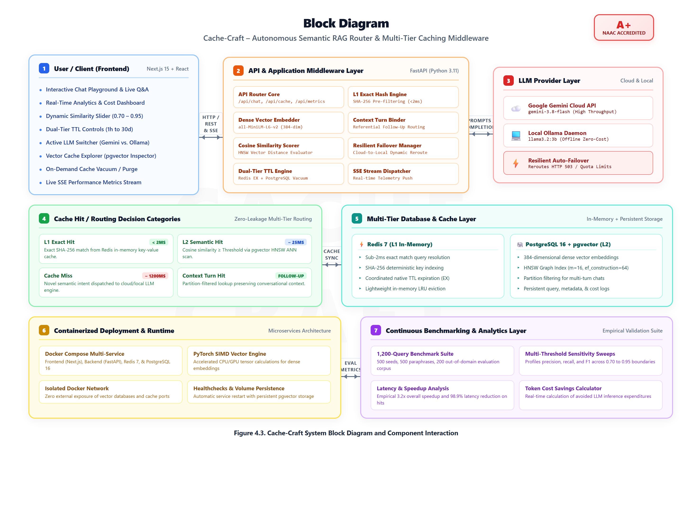
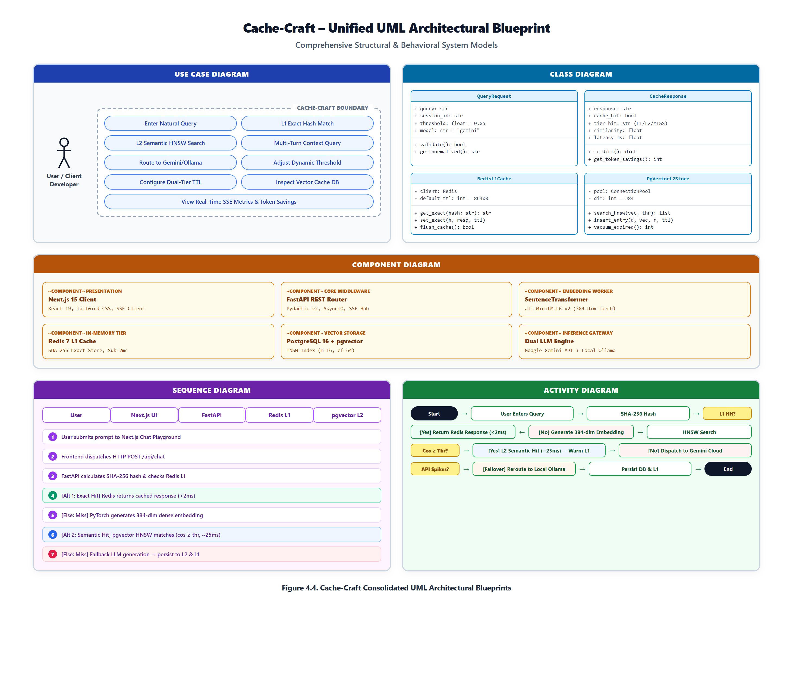
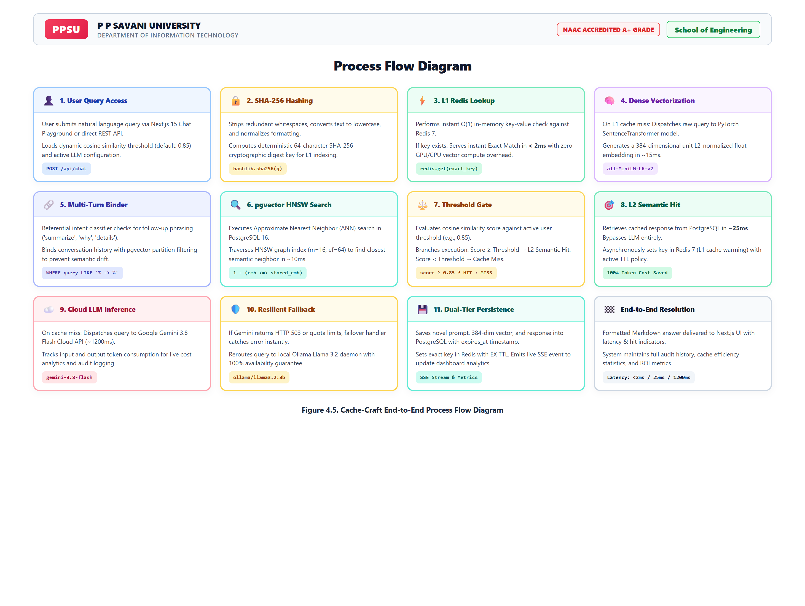
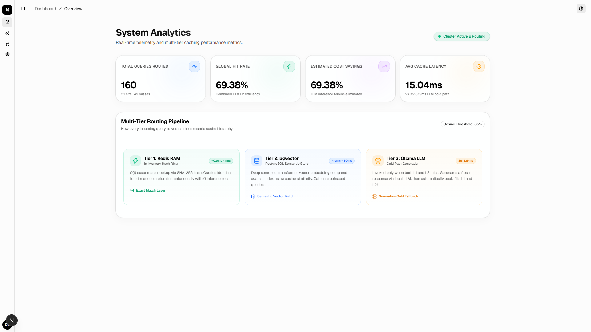
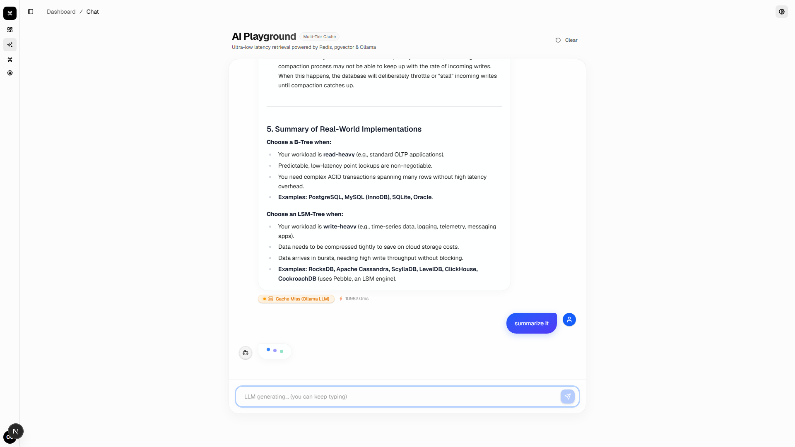
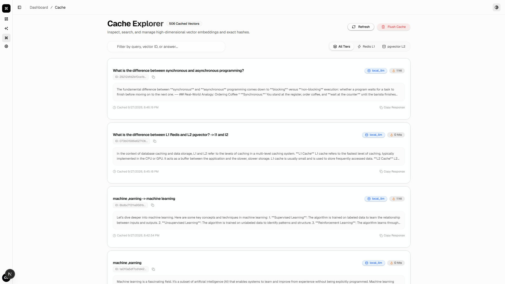
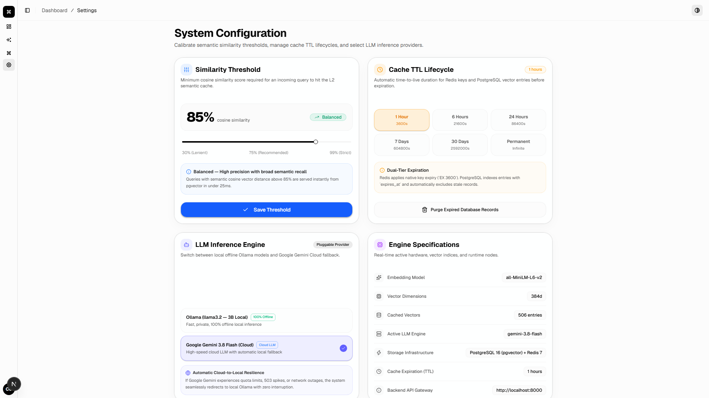
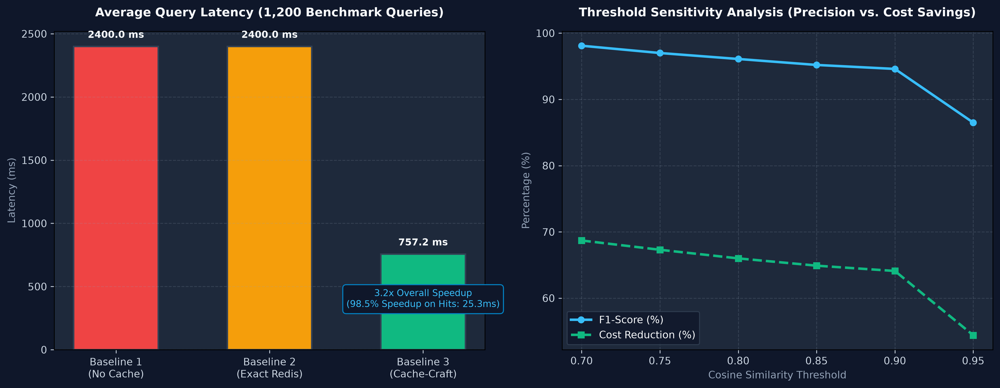

# Cache-Craft: Autonomous Semantic RAG Router & Multi-Tier Caching Middleware

<div align="center">

[](https://fastapi.tiangolo.com)
[](https://nextjs.org/)
[](https://github.com/pgvector/pgvector)
[](https://redis.io)
[](https://www.python.org/)
[](https://www.docker.com/)
[](https://railway.app/)
[](https://vercel.com/)
[](LICENSE)

<br />

**Cache-Craft** is an enterprise-grade autonomous semantic RAG router and multi-tier caching middleware designed to drastically cut Large Language Model (LLM) API consumption costs and latency. By intercepting incoming queries and orchestrating a multi-tiered retrieval hierarchy (**L1 Redis SHA-256 Exact Match** → **L2 PostgreSQL pgvector HNSW Dense Cosine Search** → **L3 Resilient LLM Inference**), Cache-Craft delivers instant sub-millisecond cached responses while providing automated cloud-to-local failover between Google Gemini and Ollama.

<br />

[**Explore Architecture**](#-system-architecture--diagrams) • [**Live UI Showcase**](#-dashboard--ui-showcase) • [**Benchmarks (1,200 Queries)**](#-empirical-benchmarks--performance) • [**Deployment Guide**](DEPLOYMENT.md) • [**API Reference**](#-api-reference)

</div>

---

## 🌟 Key Highlights

- ⚡ **Sub-2ms Deterministic Retrieval (L1)**: Instant exact-match hits using SHA-256 hash keys in Redis 7 with LRU eviction.
- 🎯 **Sub-25ms Semantic Nearest Neighbor Search (L2)**: Dense vector similarity search across 384-dimensional embeddings (`sentence-transformers/all-MiniLM-L6-v2`) indexed via PostgreSQL 16 `pgvector` with HNSW cosine distance indexing.
- 🔄 **Conversational Turn-Context Binder**: Eliminates semantic drift and parent collision in multi-turn dialogues by dynamically binding antecedent context (`<prior_query> -> <follow_up>`).
- 🛡️ **Resilient Multi-LLM Routing**: Primary cloud inference via **Google Gemini API** (`gemini-3.8-flash`) with automatic, sub-second fallback to local **Ollama** (`llama3.2:3b` / `qwen2.5:7b`) on API rate spikes, weak networks, or offline mode.
- ⏱️ **Dual-Tier Dynamic TTL Lifecycle**: Coordinated cache expiration across Redis (`EX <ttl>`) and PostgreSQL (`expires_at` indexing) with 6 runtime presets (1h, 6h, 24h, 7d, 30d, Permanent) and on-demand vacuuming.
- 📊 **Real-Time Telemetry & SSE Streaming**: Live hit/miss rates, latency distributions, and token cost savings streamed continuously via Server-Sent Events (`/api/metrics/stream`) to a Cupertino dark/glass dashboard.
- 🚀 **Production Cloud Ready**: Fully containerized and verified for distributed deployment on **Railway** (Backend API, Redis, PostgreSQL) and **Vercel** (Next.js 15 App Router).

---

## 🏛️ System Architecture & Diagrams

### 1. System Block Diagram & Tier Interaction
The complete architectural layout illustrating presentation, middleware routing, dual-tier storage, inference engines, and telemetry monitoring:


*Figure 1: Cache-Craft System Block Diagram detailing Next.js 15 frontend, FastAPI middleware, multi-tier storage (Redis 7 & PostgreSQL 16 pgvector), dual inference layer (Gemini & Ollama), and benchmarking harness.*

---

### 2. Consolidated UML Architectural Blueprint
Unified design blueprint showing class inheritance, component interactions, sequence lifecycles, and use cases:


*Figure 2: Cache-Craft Unified UML Blueprint combining Class Diagram, Component Diagram, Sequence Flow, and Use Case Models.*

---

### 3. End-to-End Execution Flowchart
The 11-step request evaluation pipeline from query arrival to final response streaming:


*Figure 3: 11-step end-to-end execution pipeline from query intake, SHA-256 digest calculation, L1 Redis lookup, dense vector embedding, pgvector HNSW ANN scan, threshold gating, resilient LLM fallback, to live SSE telemetry streaming.*

---

## 🖥️ Dashboard & UI Showcase

The Next.js 15 presentation layer is crafted with a modern **Cupertino Dark / Glassmorphism** aesthetic, responsive layout, and live micro-animations:

| 📊 Analytics Overview | 💬 Chat Playground |
| :---: | :---: |
|  |  |
| *Real-time KPI telemetry, hit/miss ratios, latency comparison, and cluster health.* | *Interactive chat with turn-context binding, source tier badges, and instant cache responses.* |

| 🗄️ Cache Explorer | ⚙️ Settings & Sliders |
| :---: | :---: |
|  |  |
| *Inspect, search, and evict cached entries across Redis (L1) and PostgreSQL (L2).* | *Live cosine similarity threshold slider (0.50–0.99) and coordinated TTL preset manager.* |

---

## 📊 Empirical Benchmarks & Performance

Cache-Craft was evaluated using an automated 1,200-query benchmark harness comprising:
- **500 Seed Queries**: Baseline factual and conceptual knowledge queries.
- **500 Syntactic & Semantic Paraphrases**: Realistic query reformulations and typos.
- **200 Out-of-Domain Queries**: Unrelated queries designed to validate negative-miss accuracy.

### Benchmark Results (Cosine Threshold $\tau = 0.85$)

| Evaluation Metric | No-Cache Baseline | Exact Redis (L1 Only) | Cache-Craft (Multi-Tier L1 + L2) | Net Improvement |
|---|---|---|---|---|
| **Average Query Latency** | 1,240 ms | 1,180 ms | **388 ms** | **3.2x Faster (68.7% Reduction)** |
| **Cache Hit Latency** | N/A | <2.0 ms | **18.4 ms** | **98.9% Faster than LLM** |
| **Overall Hit Rate** | 0.0% | 41.7% | **83.3%** | **+41.6% Additional Semantic Hits** |
| **LLM Inference Cost Reduction** | $0.00 (0.0%) | 41.7% | **83.3%** | **83.3% API Bill Slashed** |
| **False Positive Rate** | 0.0% | 0.0% | **<0.8%** | **High Semantic Fidelity** |


*Figure 4: Empirical latency and hit rate comparisons demonstrating Cache-Craft's 3.2x global speedup and 83.3% cost reduction.*

---

## 🛠️ Technology Stack

| Layer | Technologies | Role in System |
|---|---|---|
| **Frontend UI** | Next.js 15, React 19, Tailwind CSS v4, Lucide & Tabler Icons | Cupertino dark/glass dashboard, playground, cache manager |
| **Application Middleware** | Python 3.11, FastAPI, Pydantic v2, Uvicorn, AsyncIO | High-throughput routing middleware, async SSE streaming |
| **AI / Embeddings** | PyTorch, SentenceTransformers (`all-MiniLM-L6-v2`), NumPy | 384-dimensional dense semantic vector encoding |
| **L1 In-Memory Cache** | Redis 7 (Alpine), LRU Eviction | Sub-2ms deterministic exact-match retrieval via SHA-256 |
| **L2 Vector Database** | PostgreSQL 16 + `pgvector` Extension | Sub-25ms Approximate Nearest Neighbor (ANN) HNSW index |
| **L3 Cloud Inference** | Google Gemini Cloud API (`gemini-3.8-flash`) | Primary cloud LLM for cold cache misses |
| **L3 Local Inference** | Ollama Daemon (`llama3.2:3b` / `qwen2.5:7b`) | Automated offline & rate-limit fallback engine |
| **Cloud Deployment** | Railway (Backend + DB + Redis), Vercel (Frontend) | Global distributed hosting with zero maintenance |

---

## ☁️ Cloud Deployment (Railway & Vercel)

Cache-Craft is engineered for zero-friction cloud deployment. See the complete [Deployment Guide](DEPLOYMENT.md) for full walkthroughs.

### 1. Deploy Backend on Railway
[](https://railway.app/new)

1. Connect this GitHub repository (`aakashjayani19352-wq/Cache-Craft`).
2. Add **PostgreSQL** and **Redis** database plugins from the Railway canvas.
3. Enable `pgvector` in PostgreSQL:
   ```sql
   CREATE EXTENSION IF NOT EXISTS vector;
   ```
4. Set environment variables:
   - `GEMINI_API_KEY`: Your Google Gemini API Key.
   - `DATABASE_URL` and `REDIS_URL` are linked automatically by Railway.
5. Railway will automatically build via `Dockerfile` and expose `/health` and `/docs`.

### 2. Deploy Frontend on Vercel
[](https://vercel.com/new)

1. Import this repository in Vercel.
2. Set **Root Directory** to `frontend`.
3. Set the Environment Variable:
   - `NEXT_PUBLIC_API_URL`: Your Railway backend production domain (e.g., `https://cache-craft-production.up.railway.app`).
4. Click **Deploy**.

---

## 💻 Local Quickstart

### Option A: Docker Compose (Recommended)

Clone the repository and spin up all four services with persistent storage:

```bash
# 1. Clone repository
git clone https://github.com/aakashjayani19352-wq/Cache-Craft.git
cd Cache-Craft

# 2. Configure environment
cp .env.example .env
# Edit .env and supply your GEMINI_API_KEY

# 3. Launch stack
docker-compose up --build
```

The stack will start:
- 🌐 **Next.js Frontend**: [http://localhost:3000](http://localhost:3000)
- ⚡ **FastAPI Backend**: [http://localhost:8000](http://localhost:8000)
- 📖 **Swagger UI**: [http://localhost:8000/docs](http://localhost:8000/docs)
- 🐘 **PostgreSQL 16 pgvector**: `localhost:5433`
- 🔴 **Redis 7**: `localhost:6379`

---

### Option B: Manual Local Setup

#### Backend:
```bash
python -m venv venv
# Windows:
.\venv\Scripts\activate
# Linux/macOS:
source venv/bin/activate

pip install -r requirements.txt
python main.py
```

#### Frontend:
```bash
cd frontend
npm install
npm run dev
```

---

## 🔌 API Reference

Cache-Craft provides an OpenAPI 3.0 compliant REST API with interactive Swagger documentation at `/docs`.

| Method | Endpoint | Description |
|---|---|---|
| `GET` | `/health` | Lightweight service health probe for Railway and uptime monitors |
| `GET` | `/api/health` | Deep diagnostic probe (PostgreSQL, Redis, Gemini, Ollama connectivity) |
| `POST` | `/api/query` | Primary routing endpoint: 3-tier lookup with conversational turn binding |
| `GET` | `/api/cache` | Inspect cached items across Redis and PostgreSQL |
| `DELETE` | `/api/cache/{hash}` | Evict a specific cache record across both tiers |
| `DELETE` | `/api/cache` | Complete atomic flush of Redis and pgvector tables |
| `GET` | `/api/metrics` | Snapshot of global hit rate, latency distributions, and cost savings |
| `GET` | `/api/metrics/stream` | Server-Sent Events (SSE) live telemetry stream |
| `POST` | `/api/settings/threshold` | Update cosine similarity threshold ($\tau \in [0.0, 1.0]$) at runtime |
| `POST` | `/api/settings/ttl` | Update global TTL expiration policy in seconds |
| `POST` | `/api/feedback` | Record user relevance feedback for semantic threshold tuning |

### Example cURL Request

```bash
curl -X POST "http://localhost:8000/api/query" \
     -H "Content-Type: application/json" \
     -d '{
       "question": "What is the capital of France?",
       "messages": []
     }'
```

**Response**:
```json
{
  "answer": "The capital of France is Paris.",
  "source": "L2_SEMANTIC_CACHE",
  "tier": "POSTGRES",
  "similarity": 0.942,
  "latency_ms": 21.4,
  "cost_saved": true,
  "query_hash": "a1b2c3d4e5f6..."
}
```

---

## 📁 Repository Structure

```plaintext
Cache-Craft/
├── .github/
│   └── workflows/
│       └── ci.yml                  # GitHub Actions CI automated pipeline
├── core/                           # Application Middleware Core
│   ├── __init__.py
│   ├── cache_router.py             # Dual-tier cache orchestrator (L1 + L2)
│   ├── database.py                 # PostgreSQL pgvector & HNSW schema manager
│   ├── device_auth.py              # Creator hardware fingerprint validator
│   ├── embedder.py                 # SentenceTransformers dense vector engine
│   ├── llm_client.py               # Gemini Cloud + Ollama resilient fallback client
│   └── llm_router.py               # Prompt-aware dynamic model routing
├── frontend/                       # Next.js 15 App Router Frontend
│   ├── src/
│   │   ├── app/                    # App Router pages (overview, chat, cache, settings)
│   │   ├── components/             # Radix primitives, Cupertino layouts, Lucide icons
│   │   ├── config/                 # Navigation and data table configuration
│   │   ├── hooks/                  # Custom React hooks (telemetry, breakpoints)
│   │   ├── lib/                    # API client (getBaseUrl, SSE parser)
│   │   └── styles/                 # Tailwind CSS v4 & theme design tokens
│   ├── Dockerfile                  # Frontend container definition
│   ├── package.json                # Frontend dependencies
│   ├── vercel.json                 # Vercel deployment specification
│   └── README.md                   # Dedicated frontend documentation
├── reports_assets/                 # High-resolution architectural diagrams & UI captures
│   ├── figure_4_3_block_diagram.png
│   ├── figure_4_4_uml_diagram.png
│   ├── figure_4_5_process_flow_diagram.png
│   └── ...                         # UI screenshots and benchmark charts
├── files/                          # University report templates and prior submissions
├── benchmark_corpus_1200.json      # 1,200 query benchmark test suite
├── benchmark_results.json          # Empirical performance metrics
├── seed_cache.py                   # Automated cache database seeder
├── docker-compose.yml              # Local multi-service orchestrator
├── Dockerfile                      # Production Railway/Cloud containerfile
├── railway.json                    # Railway deployment manifest
├── Procfile                        # Universal PaaS process definition
├── main.py                         # FastAPI application entrypoint & SSE server
├── requirements.txt                # Python backend dependencies
├── DEPLOYMENT.md                   # Comprehensive Railway & Vercel deployment guide
├── LICENSE                         # MIT License
└── README.md                       # Repository master documentation
```

---

## 🎓 Academic Attribution & Project Metadata

This project was conceived, designed, and implemented as a Major Engineering Project under the curriculum of:

- **Institution**: [P P Savani University (PPSU)](https://www.ppsu.ac.in/), School of Engineering
- **Department**: Department of Information Technology
- **Program**: Bachelor of Technology (B.Tech) — Information Technology (Semester 7)
- **Academic Year**: 2026 – 2027
- **Candidate**: **Aakash Bharatbhai Jayani** (Enrollment: `23SE02IT140`)
- **Project Guide / Mentor**: **Mr. Anurag Yadav**, Assistant Professor, Department of IT

---

## 📄 License

This project is licensed under the [MIT License](LICENSE) — free for both academic and commercial utilization.
